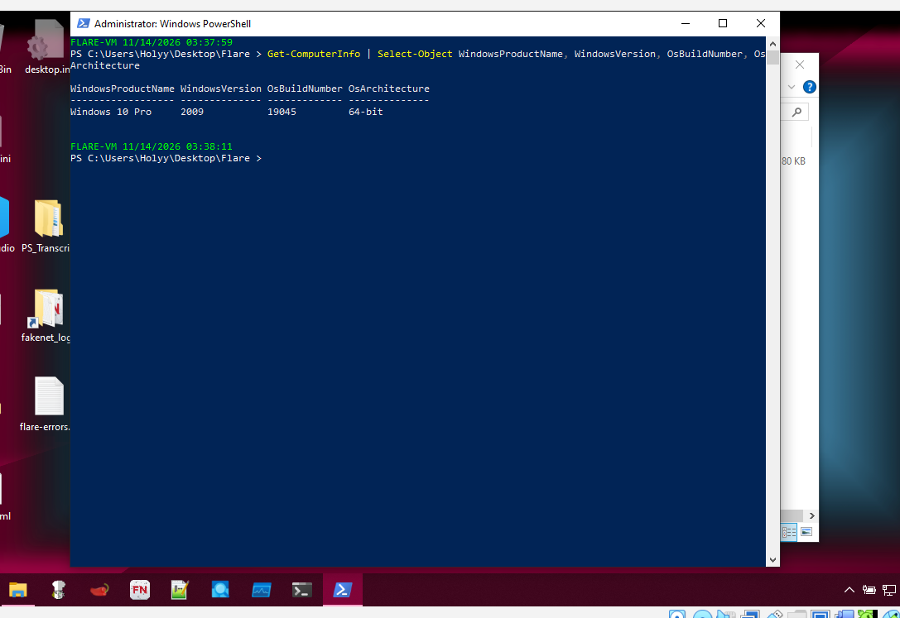
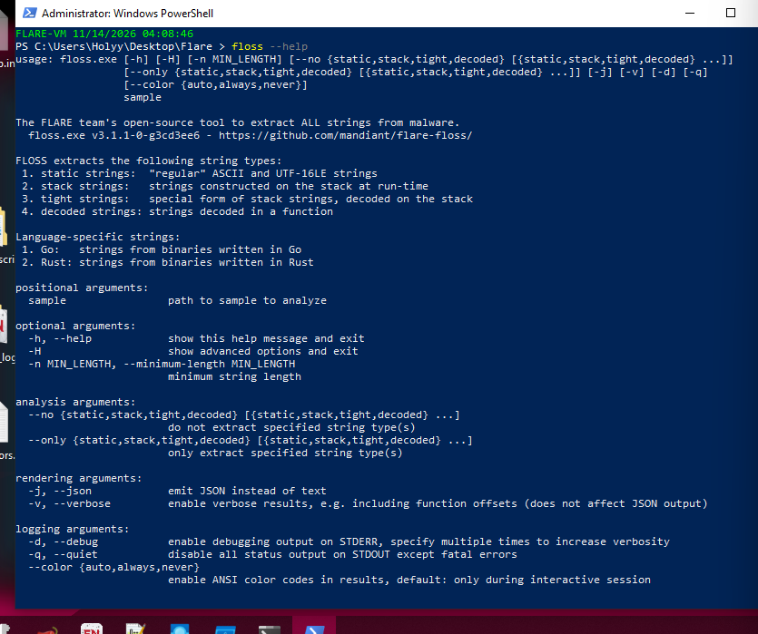
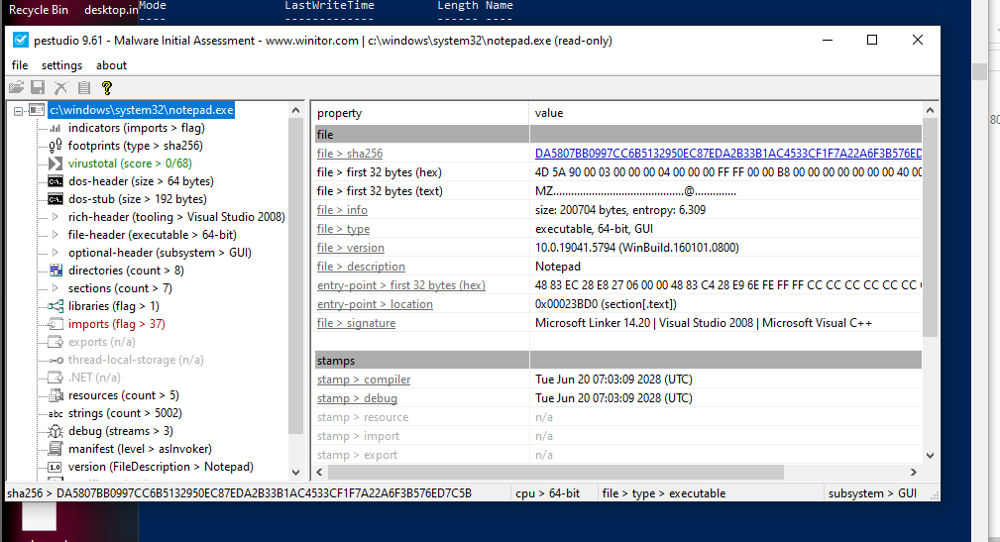
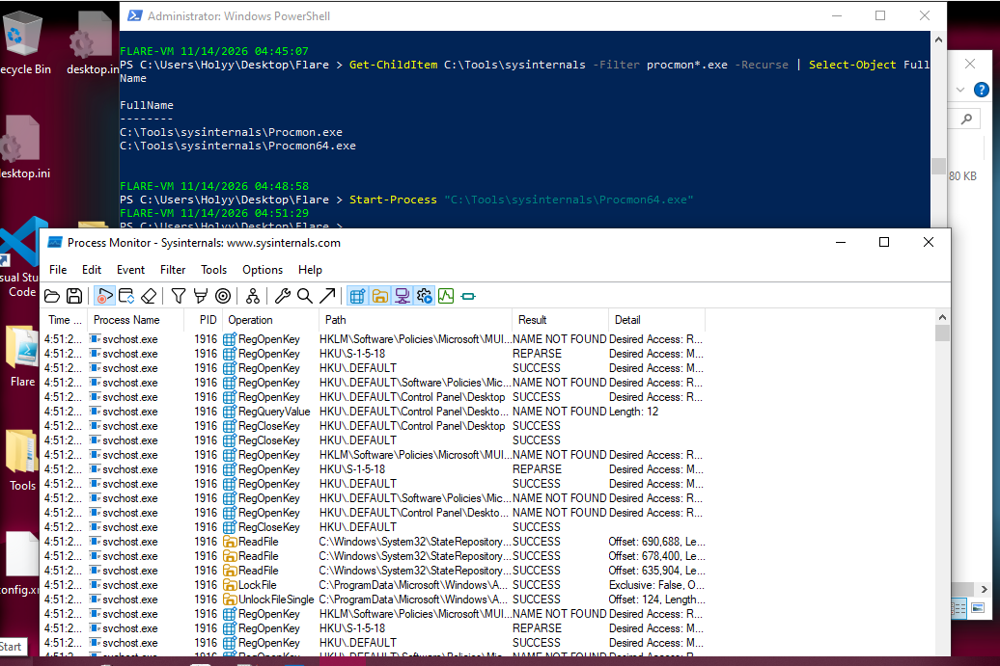
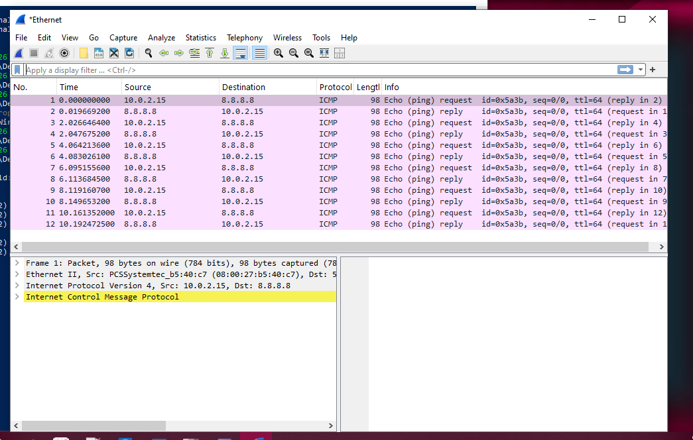
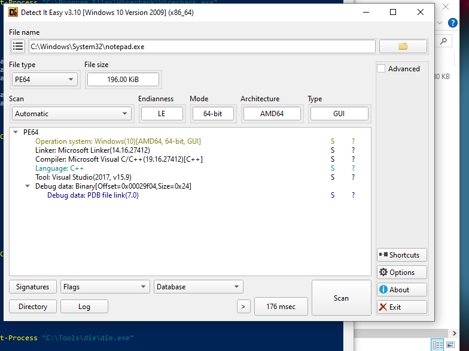
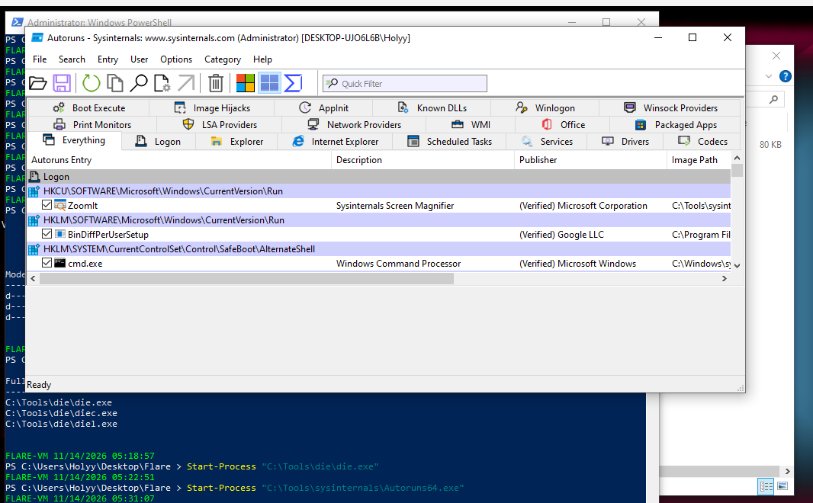
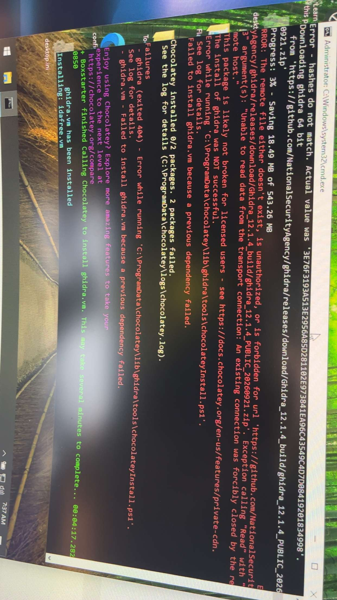
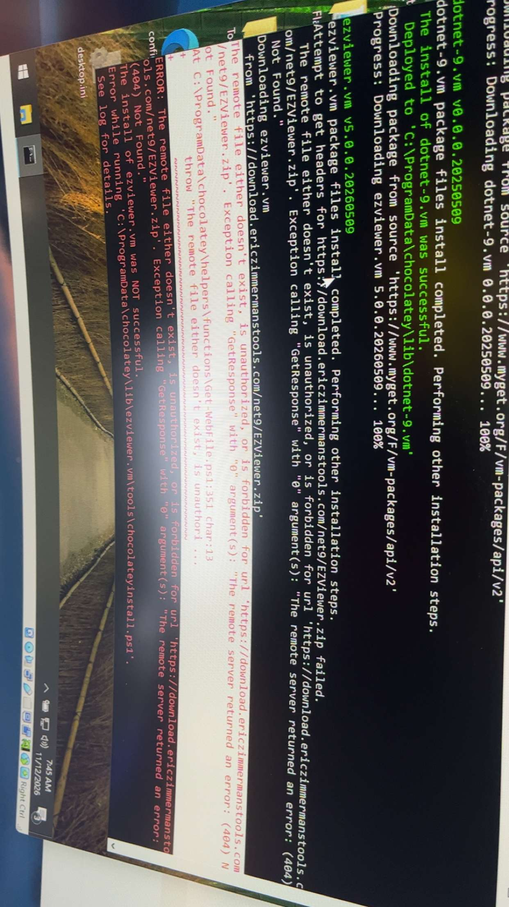

# FLARE-VM Installation, Configuration & Troubleshooting Lab

## Project Overview

This project documents my hands-on experience setting up, configuring and troubleshooting **FLARE-VM**, a Windows-based environment developed for malware analysis, reverse engineering and digital forensics.

The environment was built inside a Windows 10 virtual machine using Oracle VirtualBox.

Beyond the initial setup, I explored several tools included in the environment, performed basic static analysis of legitimate Windows executables, inspected network traffic and documented installation challenges encountered during configuration.

The project also demonstrates my experience using PowerShell to investigate installation failures, examine file integrity, calculate SHA-256 hashes and verify digital signatures.

Rather than treating installation errors as dead ends, I documented the failures and investigated their underlying causes.

## Project Objectives

- Build a Windows-based malware analysis environment.

- Install and configure FLARE-VM.

- Explore tools used in malware analysis and digital forensics.

- Practice static analysis of Windows executable files.

- Examine executable properties, architecture and compiler information.

- Monitor Windows processes and system activity.

- Capture and inspect network traffic.

- Investigate Chocolatey package installation failures.

- Use PowerShell for troubleshooting and system administration.

- Calculate SHA-256 hashes and examine digital signatures.

- Document technical findings and troubleshooting procedures.

- Practice Git and GitHub version control.

## Lab Environment

| Component | Configuration |

|---|---|

| Host virtualization | Oracle VirtualBox |

| Guest operating system | Windows 10 Pro |

| OS Build | 19045 |

| Environment | FLARE-VM |

| Package manager | Chocolatey |

| Command-line interface | PowerShell |

| Version control | Git |

| Repository hosting | GitHub |

## Tools Explored

The following tools were accessed and tested during the project.

| Tool | Purpose |

|---|---|

| FLOSS | Extracting and analyzing strings from executable files |

| PEStudio | Inspecting executable properties and potential malware indicators |

| Detect It Easy (DIE) | Identifying executable formats, compilers and architectures |

| Process Monitor (Procmon) | Monitoring Windows processes, registry operations and file activity |

| Wireshark | Capturing and analyzing network traffic |

| Autoruns | Examining Windows startup entries and persistence locations |

| PowerShell | System administration and installation troubleshooting |

| Chocolatey | Windows software package management |

## Practical Exercises

### 1. Static Executable Analysis

I used PEStudio and Detect It Easy to examine the legitimate Windows Notepad executable (`notepad.exe`).

The exercises included:

- Examining executable properties.

- Identifying file architecture and format.

- Inspecting compiler and linker information.

- Reviewing file metadata.

- Examining executable indicators and strings.

These exercises provided an introduction to static analysis without executing an unknown or malicious sample.

### 2. Process Monitoring

I launched Process Monitor to observe Windows system activity.

The captured activity included:

- Process names and identifiers.

- Registry operations.

- File operations.

- Operation results.

This provided practical exposure to monitoring processes and understanding Windows system behaviour.

### 3. Network Traffic Analysis

I used Wireshark to capture and inspect network traffic.

The exercise included observing ICMP echo requests and replies, identifying source and destination IP addresses, and examining packet details.

This provided practical experience with basic network traffic inspection.

### 4. Startup and Persistence Inspection

I explored Microsoft Sysinternals Autoruns to inspect Windows startup entries.

The interface provided visibility into several startup locations, including:

- Logon entries.

- Registry Run keys.

- Services.

- Drivers.

- Scheduled Tasks.

This introduced the role of startup-entry inspection when investigating potential persistence mechanisms.

### 5. String Extraction

I launched FLOSS and verified its functionality through PowerShell.

I explored its command-line options and its capabilities for extracting strings from executable files.

## Installation and Troubleshooting

The FLARE-VM setup process involved several installation challenges.

Rather than bypassing security checks, I investigated the reported errors and documented the outcomes.

### Ghidra Installation Issue

During the Ghidra installation attempt, Chocolatey reported a SHA-256 checksum mismatch alongside a download failure.

This highlighted the importance of software integrity verification and investigating unexpected changes in downloaded files.

### EZViewer Installation Issue

The EZViewer installation attempt returned an HTTP 404 error.

Although the .NET 9 dependency installed successfully, the EZViewer package download failed.

This demonstrated how an unavailable download resource can interrupt an otherwise successful package installation process.

### Digital Signature Verification

I also investigated Authenticode digital signatures and certificate trust during the troubleshooting process.

The exercise reinforced the importance of verifying software publishers and examining certificate chains before trusting downloaded software.

**Note:** The documented Ghidra and EZViewer installation failures are retained as troubleshooting evidence. They are not presented as successfully resolved installations.

## Security Considerations

Security was an important consideration throughout the project.

- Used official developer sources when manually obtaining software.

- Examined SHA-256 hashes.

- Investigated digital signature validity.

- Avoided bypassing checksum verification.

- Did not manually trust an untrusted root certificate.

- Used a virtual machine to isolate the analysis environment from the host operating system.

- Used a legitimate Windows executable for the demonstrated static analysis exercises.

## Screenshots and Evidence

The following folders contain screenshots documenting the environment, tool verification and troubleshooting activities.

| Folder | Description |

|---|---|

| [Installation](screenshots/installation/) | System information, FLARE-VM tools directory and installed packages |

| [Verification](screenshots/verification/) | FLOSS, PEStudio, Procmon, Wireshark, DIE and Autoruns |

| [Troubleshooting](screenshots/troubleshooting/) | Digital signature verification, Chocolatey, Ghidra and EZViewer errors |

### Selected Evidence

**System Information**

**FLOSS Functionality**

**PEStudio Static Analysis**

**Process Monitor**

**Wireshark Network Traffic Capture**

**Detect It Easy Static Analysis**

**Autoruns**

**Installation Troubleshooting**

## Learning Outcomes

Through this project, I gained practical experience with:

- Setting up a Windows-based malware analysis environment.

- Exploring reverse-engineering and malware analysis tools.

- Performing basic static executable analysis.

- Monitoring Windows processes and registry activity.

- Capturing and inspecting network traffic.

- Examining Windows startup entries.

- Using PowerShell to troubleshoot installation failures.

- Understanding software integrity checks and digital signatures.

- Documenting technical challenges and findings.

- Managing project documentation with Git and GitHub.

## Project Status

The initial FLARE-VM environment setup and evidence collection have been completed.

A total of 19 screenshots document the installation environment, tool functionality, practical exercises and troubleshooting activities.

Further work can build on this foundation through controlled malware analysis exercises, deeper reverse engineering and additional investigation techniques.

## Disclaimer

This repository documents an independent cybersecurity learning project.

All exercises were conducted in a controlled virtual machine environment for educational purposes.

The static analysis demonstrations used a legitimate Windows executable. This project does not claim to represent a completed investigation of a malicious sample.

